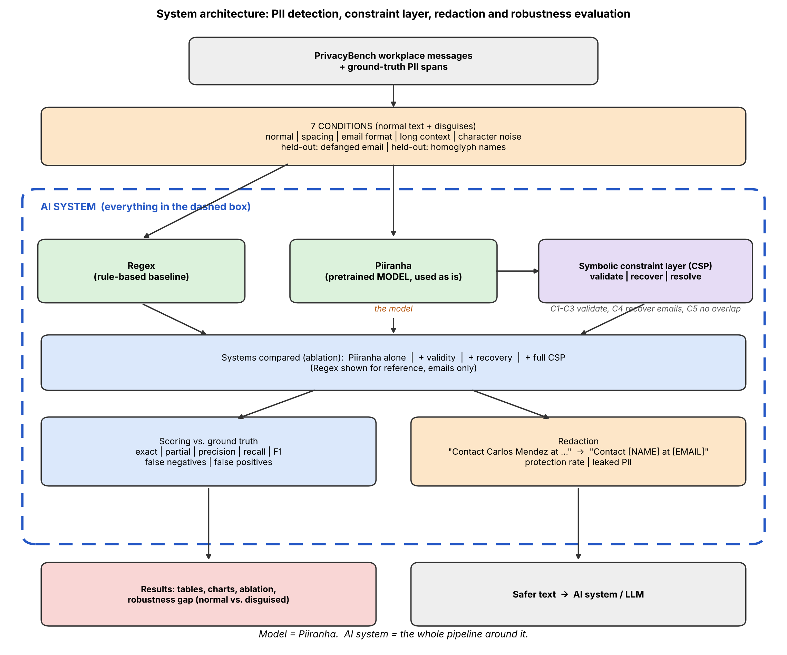

# Evaluating the Robustness of AI-Based PII Detection for Secure LLM Input

CSCI 493 course project (Hunter College, CUNY) by **Wendy Zheng** and **Angela Guo**.

People paste work text into AI tools, and that text can contain names, email addresses, usernames and organizations. This project tests how well PII (personally identifiable information) detectors protect that text *before* it reaches an LLM, especially when the PII is deliberately disguised.

## Goals

- **Measure** how well a simple rule (Regex) and a pretrained AI model (Piiranha) find PII in workplace messages.
- **Stress-test** both with disguises (spaced-out letters, emails written as words, and so on) to see where they break.
- **Measure what leaks:** after redaction, how much PII would still reach the LLM?
- **Test a hybrid:** does adding a symbolic constraint layer (hand-written rules) to Piiranha improve detection and robustness? An ablation study switches each piece on and off to find out.

## Key concepts in plain English

| Term | What it means here |
|---|---|
| **PII** | personally identifiable information: here, names, email addresses, usernames and organizations |
| **Ground-truth label** | the dataset's answer key: it marks which characters of a message are PII and what type they are (stored as a start position, an end position and a type, so the code also calls it a *span*) |
| **Regex** | a hand-written pattern rule (for example, "letters, then @, then a domain"). Nothing is trained; it only matches the exact format it was written for. It is our baseline and only finds emails |
| **Piiranha** | an existing AI model (a pretrained transformer) that reads text and labels PII. We use it as is, with no extra training |
| **Constraint layer (CSP)** | hand-written rules that sit after Piiranha. Each detection is accepted or rejected by the rules, and the rules can also add emails Piiranha missed. CSP stands for constraint satisfaction problem |
| **Ablation study** | switching one piece of the system on or off at a time to see what each piece contributes |
| **Disguise (obfuscation)** | rewriting PII so it is harder for a detector to catch but still readable to a person |
| **Held-out disguise** | a disguise the constraint rules were *not* written for, used to test whether they generalize |
| **Precision** | of the PII a detector flagged, the share that was real PII (low precision = many false alarms) |
| **Recall** | of the real PII, the share the detector found (low recall = PII missed) |
| **F1** | one number that balances precision and recall |
| **False negative / false positive** | PII that was missed / text wrongly flagged as PII |
| **Protection rate** | the share of PII whose every character is covered by redaction |
| **Leaked PII** | PII that would still reach the LLM after redaction |

## Project question and research questions

Can a pretrained PII detector (Piiranha) protect sensitive information in workplace text better than a Regex baseline, while keeping high recall when PII is disguised? And does adding a symbolic constraint layer to Piiranha improve detection and robustness?

1. How accurately can different approaches detect PII in workplace messages?
2. How does modifying or disguising PII affect detection performance?
3. Which types of PII are hardest to detect?
4. How effectively can detected PII be redacted before text is sent to an AI system?
5. Does adding a symbolic constraint layer (CSP) to Piiranha improve detection and robustness? (ablation study)

## Approach

### Systems compared

| System | Type | Role |
|---|---|---|
| **Regex** | rule-based (hand-written pattern, no training) | baseline; detects emails only |
| **Piiranha** ([`iiiorg/piiranha-v1-detect-personal-information`](https://huggingface.co/iiiorg/piiranha-v1-detect-personal-information)) | pretrained transformer, used as is | the AI model |
| **Piiranha + constraint layer (CSP)** | neural model plus hand-written rules | the hybrid under ablation |

Piiranha has no organization label, so organizations are reported as *unsupported* rather than counted against its precision and recall.

### Architecture

The **model** is Piiranha. The **AI system** is the whole pipeline around it (the dashed box in the diagram).



*(The notebook saves this image to `results/` when it runs.)*

### Symbolic constraint layer (CSP)

Piiranha is a learned model, so it can be wrong in ways nobody wrote down. The constraint layer adds explicit, hand-written rules *after* Piiranha so that its detections can be checked, repaired and cleaned up. It is the "symbolic" half of the hybrid.

**How it works, step by step**

1. **Candidates.** Every Piiranha detection is a candidate. (If recovery is on, every email found by the symbolic email rules is a candidate too.)
2. **Validate (C1 to C3).** A candidate that breaks a shape rule is removed.
3. **Recover (C4).** Rules add emails in four formats even if Piiranha missed them.
4. **Resolve (C5).** When candidates overlap, only one can stay. A structurally valid email outranks model confidence.
5. **Output.** The surviving detections are redacted exactly like any other detector's.

**Why this counts as a constraint problem.** Each candidate is a *variable* that can be accepted or rejected. C1 to C3 are rules on a single candidate; C5 is a rule between two candidates (they may not overlap). The solver keeps the set of accepted candidates with the highest total confidence that breaks no rule, using backtracking search inside each group of overlapping candidates. Emails found by the rules are weighted above any model confidence. It is a small constraint-optimization problem, not a large solver.

| Rule | Kind | What it enforces |
|---|---|---|
| C1 email structure | validate | keep a Piiranha email only if it reads as `name@domain.tld` once `at`/`dot`, brackets and spaces are treated as symbols |
| C2 username shape | validate | no spaces; 2 to 30 characters of letters, digits, `.` `_` `-` |
| C3 name shape | validate | contains a letter, no `@`, at most 40 characters, not an email |
| C4 email recovery | repair | rules find emails in four formats (normal, spaced punctuation, `at`/`dot` words, bracketed) even if Piiranha missed them |
| C5 no overlap | resolve | accepted detections cannot share characters; a structurally valid email outranks model confidence |

**Worked example.** Message: `Contact Carlos Mendez at carlos dot mendez at example dot com.` Suppose Piiranha flags only part of the address, `carlos dot mendez`.

| Step | What happens |
|---|---|
| Piiranha proposes | a partial email span, `carlos dot mendez` |
| C1 validate | the partial span does not read as `name@domain.tld`, so it is rejected |
| C4 recover | the `at`/`dot` rule finds the whole address, `carlos dot mendez at example dot com` |
| C5 resolve | if the partial span were still present, the whole-address candidate would win the overlap |
| Result | the whole address is redacted, instead of leaving `at example dot com` exposed |

**A rule that can backfire.** If Piiranha labels `Carlos Mendez` as a USERNAME, C2 rejects it, because usernames have no spaces, even though that detection covered a real name. Rejections like this are the likely reason validity lowers protection in the ablation (we have not confirmed this).

**Ablation variants:** Piiranha alone, + validity only (C1 to C3), + recovery only (C4 and C5), + full CSP (all rules). The layer cannot recover missed names, because names have no strict format.

**The ablation in one sentence:** recovery helped, validity cost protection, the full layer had the best F1 but leaked more PII, and it failed on the unseen defanged format.

## Dataset

[**PrivacyBench**](https://huggingface.co/datasets/TonicAI/Privacy-Bench) (Tonic AI): a public, fully synthetic benchmark of workplace email and Slack-style messages across 21 fictional environments, with ground-truth labels for five PII types: given names, family names, email addresses, usernames and organizations. No real personal data is used.

**Used for the results below:** 3 environments (`aaron_pfizer`, `devon_marriott_international`, `megan_donovan_eli_lilly`), 200 randomly sampled messages each (seed 42), 600 messages in total. They contain 885 ground-truth labels: 128 emails, 524 given names, 77 family names, 64 usernames and 92 organizations.

## Disguise conditions

Each condition rewrites the PII and updates the ground-truth labels so scoring still points at the right characters. No ground-truth labels were dropped in any condition, so every condition was scored on the same PII.

| Condition | What changes | Example |
|---|---|---|
| Normal | nothing | `Carlos Mendez`, `carlos.mendez@example.com` |
| Spacing | letters of names spaced out | `C a r l o s` |
| Email format | `@` and `.` written as words | `carlos dot mendez at example dot com` |
| Long context | message wrapped in unrelated filler text | same PII, much more surrounding text |
| Character noise | spaced email punctuation; digit look-alikes in names | `carlos . mendez @ example . com`, `C4rl0s` |
| Held-out: defanged | emails written with `[.]` and `[@]` | `carlos[.]mendez[@]example[.]com` |
| Held-out: homoglyph | Latin letters swapped for look-alike Cyrillic letters | `Cаrlos` (the "а" is Cyrillic) |

## How we measure

Priority order: **false negatives and leaked PII first**, then false positives, then F1.

- **Partial-span detection (what precision, recall and F1 use):** a detection counts if it overlaps a ground-truth label and has the right type.
- **Successful redaction (protection rate, leaked PII):** a label counts as protected only if every non-space character of it is covered, whatever type the detector gave it.
- **Exact-span detection** (same start, end and type) is planned but not computed yet.

## Results

*One run, seed 42, 600 messages from 3 environments. Results are preliminary and come from synthetic data.*

### 1. Emails: Regex vs. Piiranha vs. the hybrid (F1)

| System | Normal | Spacing | Email format | Long context | Character noise | Held-out: defanged | Held-out: homoglyph |
|---|---|---|---|---|---|---|---|
| Regex | 1.000 | 1.000 | 0.000 | 1.000 | 0.000 | 0.000 | 1.000 |
| Piiranha alone | 0.916 | 0.919 | 0.088 | 0.937 | 0.858 | 0.555 | 0.927 |
| Piiranha + validity | 0.775 | 0.769 | 0.046 | 0.757 | 0.775 | 0.000 | 0.781 |
| Piiranha + recovery | 0.992 | 0.985 | 0.980 | 0.981 | 0.988 | 0.555 | 0.988 |
| Piiranha + full CSP | 1.000 | 1.000 | 1.000 | 1.000 | 1.000 | 0.000 | 1.000 |

- Regex is perfect on clean emails and fails on any disguise that changes the format.
- Piiranha is more flexible (F1 0.86 under character noise) but misses more on clean text, and nearly collapses when emails are written as words (F1 0.09).
- Detected is not the same as protected. Piiranha found 114 of 128 emails on normal text, but only 97 were fully covered by redaction, so 31 emails would leak at least in part.

**Share of emails fully protected after redaction:**

| System | Normal | Spacing | Email format | Long context | Character noise | Held-out: defanged | Held-out: homoglyph |
|---|---|---|---|---|---|---|---|
| Regex | 100.0% | 100.0% | 0.0% | 100.0% | 0.0% | 0.0% | 100.0% |
| Piiranha alone | 75.8% | 75.8% | 24.2% | 75.8% | 74.2% | 25.0% | 76.6% |
| Piiranha + validity | 63.3% | 62.5% | 2.3% | 60.9% | 63.3% | 0.0% | 64.1% |
| Piiranha + recovery | 100.0% | 99.2% | 96.9% | 99.2% | 99.2% | 25.0% | 100.0% |
| Piiranha + full CSP | 100.0% | 100.0% | 99.2% | 100.0% | 99.2% | 0.0% | 100.0% |

### 2. Names, usernames and the rest (Piiranha alone, normal text)

| PII type | Ground-truth labels | Found (TP) | False alarms (FP) | Recall | Fully protected |
|---|---|---|---|---|---|
| EMAIL_ADDRESS | 128 | 114 | 7 | 0.891 | 75.8% |
| NAME_GIVEN | 524 | 44 | 0 | 0.084 | 38.7% |
| NAME_FAMILY | 77 | 21 | 6 | 0.273 | 71.4% |
| USERNAME | 64 | 2 | 227 | 0.031 | 0.0% |

- Given names: only 44 of 524 were found with the right type, yet 38.7% were fully covered by some detection. Usernames: 227 false alarms and almost none found.
- This pattern fits Piiranha often labelling names as a different type (for example, as usernames). We have not confirmed it; check the error examples in Section 13 of the notebook.
- Organizations (92 labels) cannot be detected by Piiranha at all.
- **Names under disguise behave differently from emails.** Spacing raised family-name false alarms from 6 to 130 and cut fully protected family names from 71.4% to 26.0%. Character noise cut family-name recall from 0.273 to 0.078. Homoglyphs raised recall (given names 0.084 to 0.254) but added false alarms.

### 3. How much PII still leaks, including organizations (Piiranha alone)

- Of the 885 ground-truth labels, **510 (57.6%)** were still exposed on normal text once the 92 organization labels (which Piiranha cannot detect) are counted.
- The worst condition was emails written as words: **581 (65.6%)** exposed. The best was homoglyph names: **451 (51.0%)**.

### 4. Does the symbolic layer help? (ablation, all supported PII: names, emails, usernames)

**Normal text:**

| System | Precision | Recall | F1 | Fully protected | Leaked |
|---|---|---|---|---|---|
| Piiranha alone | 0.430 | 0.228 | 0.298 | 44.8% | 438 |
| Piiranha + validity | 0.516 | 0.187 | 0.274 | 30.1% | 554 |
| Piiranha + recovery | 0.463 | 0.246 | 0.321 | 48.4% | 409 |
| Piiranha + full CSP | 0.596 | 0.246 | 0.348 | 36.1% | 507 |

**Share of supported PII fully protected after redaction:**

| System | Normal | Spacing | Email format | Long context | Character noise | Held-out: defanged | Held-out: homoglyph |
|---|---|---|---|---|---|---|---|
| Piiranha alone | 44.8% | 44.8% | 35.8% | 42.7% | 42.5% | 36.4% | 52.1% |
| Piiranha + validity | 30.1% | 27.5% | 19.9% | 24.8% | 29.0% | 19.8% | 35.3% |
| Piiranha + recovery | 48.4% | 48.3% | 47.5% | 46.4% | 46.3% | 36.4% | 55.7% |
| Piiranha + full CSP | 36.1% | 33.5% | 35.6% | 31.1% | 34.8% | 19.8% | 41.1% |

**Leaked PII (number of ground-truth labels still exposed, out of 793):**

| System | Normal | Spacing | Email format | Long context | Character noise | Held-out: defanged | Held-out: homoglyph |
|---|---|---|---|---|---|---|---|
| Piiranha alone | 438 | 438 | 509 | 454 | 456 | 504 | 380 |
| Piiranha + validity | 554 | 575 | 635 | 596 | 563 | 636 | 513 |
| Piiranha + recovery | 409 | 410 | 416 | 425 | 426 | 504 | 351 |
| Piiranha + full CSP | 507 | 527 | 511 | 546 | 517 | 636 | 467 |

**F1:**

| System | Normal | Spacing | Email format | Long context | Character noise | Held-out: defanged | Held-out: homoglyph |
|---|---|---|---|---|---|---|---|
| Piiranha alone | 0.298 | 0.302 | 0.115 | 0.291 | 0.209 | 0.246 | 0.414 |
| Piiranha + validity | 0.274 | 0.302 | 0.135 | 0.267 | 0.203 | 0.134 | 0.426 |
| Piiranha + recovery | 0.321 | 0.322 | 0.312 | 0.305 | 0.251 | 0.246 | 0.433 |
| Piiranha + full CSP | 0.348 | 0.371 | 0.346 | 0.346 | 0.276 | 0.134 | 0.488 |

- **Recovery** (rules that find disguised emails) helps everywhere it applies: better email results and the best protection overall.
- **Validity** (rules that reject detections) raises precision but lowers recall and protection, because it throws out partial or oddly typed detections that still covered real PII.
- **Full CSP** has the best F1 and precision, but *leaks more PII* than Piiranha alone in 20 of 21 environment-condition pairs.
- **Held-out defanged emails:** full CSP scored F1 0.000 (Piiranha alone 0.555) because the validity rule rejects formats it does not know. Hard-coded rules were worse than the model on a disguise they were not written for.
- The perfect email scores in the designed conditions mostly reflect rules written for exactly those formats, so the held-out result is the fairer test of generalization.
- The same pattern held in each environment (full CSP raised supported F1 in 18 of 21 pairs, all except the three defanged tests).

### Hypotheses vs. results

| Hypothesis | Verdict |
|---|---|
| H1: on clean text Regex matches or beats Piiranha on emails; only Piiranha can find names and usernames | Supported (Regex F1 1.000 vs. 0.916), though Piiranha finds few names |
| H2: changing email syntax hurts Regex more than Piiranha | Partly supported: Regex lost everything under character noise and defanging, but both collapse when emails are written as words |
| H3: names and usernames are harder than emails for the model | Supported (recall 0.084 given names, 0.031 usernames, vs. 0.891 emails) |
| H4: redaction leaves a large share of PII exposed | Supported (only 44.8% of supported PII fully protected on normal text) |
| H5: the symbolic layer improves robustness | Mixed: better precision and email robustness on known formats, but more leaks overall and failure on an unseen format |

## Conclusion

We evaluated 600 PrivacyBench messages from 3 environments (`aaron_pfizer`, `devon_marriott_international`, `megan_donovan_eli_lilly`). On normal text, Regex achieved email F1 1.000 and Piiranha 0.916. Under email-format obfuscation, Regex's email recall fell to 0.000 and Piiranha's to 0.047. Piiranha's weakest supported type was usernames (recall 0.031, with given names close behind at 0.084), and it cannot detect organizations. Redaction fully protected 44.8% of supported PII on normal text and 35.8% under the hardest condition, leaving 438 and 509 labels exposed respectively. In the ablation, adding the full constraint layer changed supported-PII F1 from 0.298 to 0.348 on normal text and email recall from 0.047 to 1.000 under email-format disguise, but it leaked more PII overall and did not help on the held-out defanged emails (email F1 0.000 vs. 0.555). These results suggest that no single detector is a reliable privacy filter, that detection scores overstate how safe redacted text is, and that rules which *add* detections are more useful for protection than rules which *reject* them.

## What we learned

- **No single detector is enough.** Regex is exact but brittle; Piiranha is flexible but leaves a lot of PII exposed, especially names and usernames.
- **Detecting is not protecting.** A detection can overlap PII without covering all of it, so detection scores overstate how safe the redacted text is.
- **Rules that add detections help; rules that reject detections trade protection for precision.** For a privacy filter, where missed PII is the costly error, the recovery rules are the useful part.
- **Rules written for known disguises do not automatically carry over to new ones.** The held-out test showed that.
- **Disguises changed how Piiranha labels names more than whether it sees them.** Spacing and homoglyphs raised given-name recall instead of lowering it, while spacing also multiplied family-name false alarms; we cannot yet explain this.
- **Strict label-matched false positives overstate over-redaction,** since some are real PII with the wrong type. A direct over-redaction measure is future work.

### Practical recommendation

Use Piiranha plus the recovery rules as a *first layer* before text reaches an LLM, leave out hard rejection rules unless precision matters more than leakage, and treat names and usernames as largely exposed. Combine it with other controls rather than relying on it alone.

## Limitations

- PrivacyBench is synthetic, so results may not transfer to real workplace text.
- Only a sample from 3 of the 21 environments (600 messages, 34 to 55 emails per environment); one run, no significance tests.
- Regex only detects conventional emails by design, so the head-to-head comparison is email-only.
- Piiranha has no organization label, and the constraint rules cannot recover names.
- The disguises are controlled examples, not every evasion technique; the held-out test uses a single unseen email format.
- Overlap-based, type-matched scoring can count partial overlap as a match; protection rate is stricter and ignores type.
- The constraint rules are hand-written around known formats.
- Very long messages are split into pieces, so an entity cut at a boundary could be missed.
- A detector can miss sensitive data. Redaction should be one layer of defence, not a guarantee.
- The explanation for the weak name and username results (labelled as the wrong type) is a hypothesis that has not been confirmed.

## Future work

- Add exact-span and over-redaction metrics.
- Inspect the name and username errors to confirm or reject the mislabelling explanation.
- Test more environments, more runs and more held-out disguises.
- Make the validity rules tolerant of unknown formats, or only use them to flag rather than reject detections.

## Repository contents

```
.
├── PII_Robustness_PrivacyBench_FINAL.ipynb   # the full experiment (run top to bottom)
├── README.md
└── results/                                  # created when the notebook runs
    ├── architecture_diagram.png
    ├── all_results_by_condition.csv
    ├── email_regex_vs_piiranha.csv
    ├── piiranha_by_pii_type_and_condition.csv
    ├── protection_and_leakage.csv
    ├── results_by_environment.csv
    ├── ablation_by_condition.csv
    ├── ablation_by_environment.csv
    └── dropped_ground_truth_labels.csv
```

## How to run

Open `PII_Robustness_PrivacyBench_FINAL.ipynb` and run it top to bottom. The notebook's install cell installs `transformers>=4.45,<5`, `huggingface_hub`, `pandas`, `matplotlib`, `numpy<2` and `torch`. Restart the kernel after installing, then run every cell from the imports cell down (plus the Section 1 diagram cell so the diagram can be saved). The dataset and model download automatically (no login needed).

Piiranha is the slow step. To run faster, lower `N_MESSAGES`, set `N_EXTRA_ENVIRONMENTS = 0`, or set `USE_HELDOUT_CONDITIONS = False`.

Key settings are in Section 3 of the notebook: `PRIMARY_DATASET`, `N_EXTRA_ENVIRONMENTS`, `DATASET_NAMES_OVERRIDE`, `N_MESSAGES`, `SEED`, `USE_HELDOUT_CONDITIONS`.

## Related work

- *Benchmarking Modern Named Entity Recognition Techniques for Free-text Health Record Deidentification*: https://pmc.ncbi.nlm.nih.gov/articles/PMC8378656
- Johnson et al., *Deidentification of Free-text Medical Records Using Pre-trained Bidirectional Transformers*: https://pmc.ncbi.nlm.nih.gov/articles/PMC8330601
- Lukas et al., *Analyzing Leakage of Personally Identifiable Information in Language Models*, IEEE S&P 2023: https://www.microsoft.com/en-us/research/publication/analyzing-leakage-of-personally-identifiable-information-in-language-models
- Zafar and Nowaczyk, *Mind the Gap: Robustness Risks in PII Detection Systems*, arXiv:2609.03464 (preprint)
- Mishra, Pagare and Sharma, *A hybrid rule-based NLP and machine learning approach for PII detection and anonymization in financial documents*, Scientific Reports, 2025. DOI: 10.1038/s41598-025-04971-9
